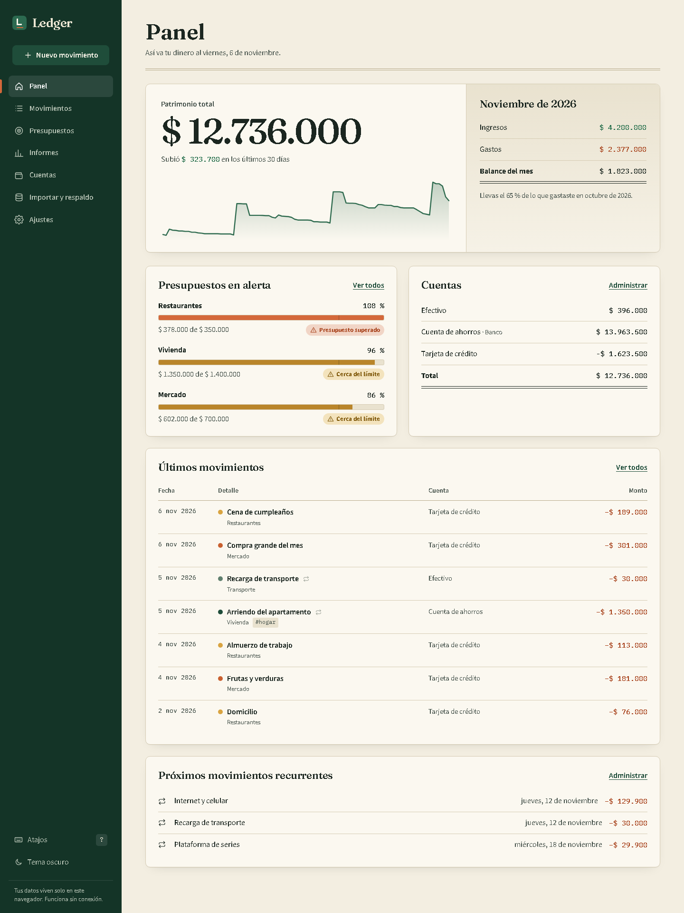
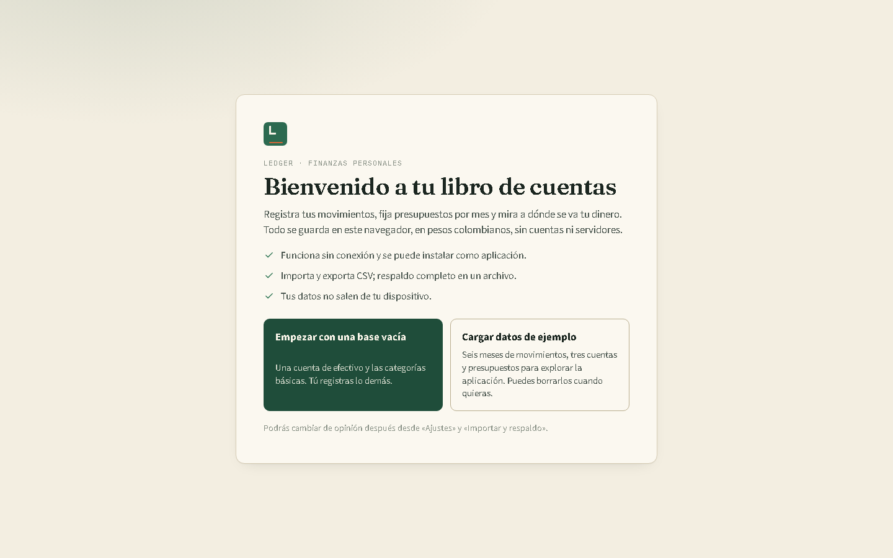
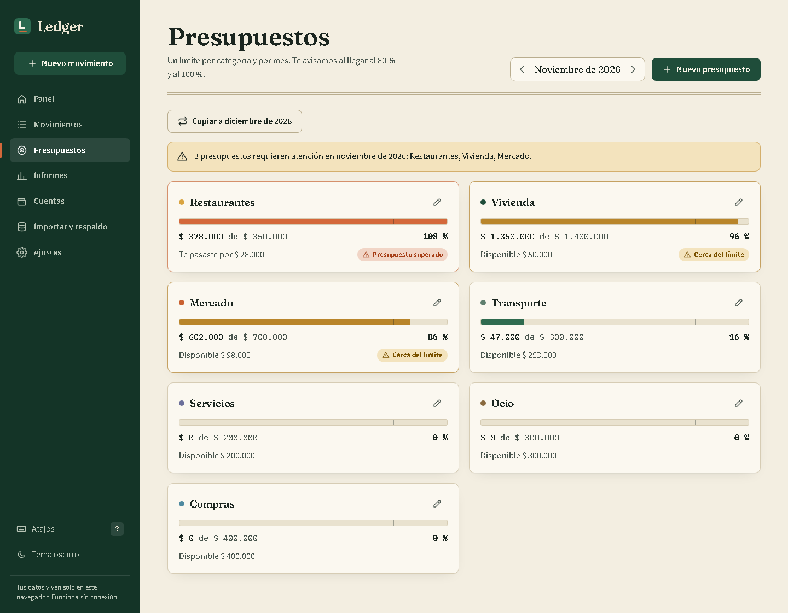
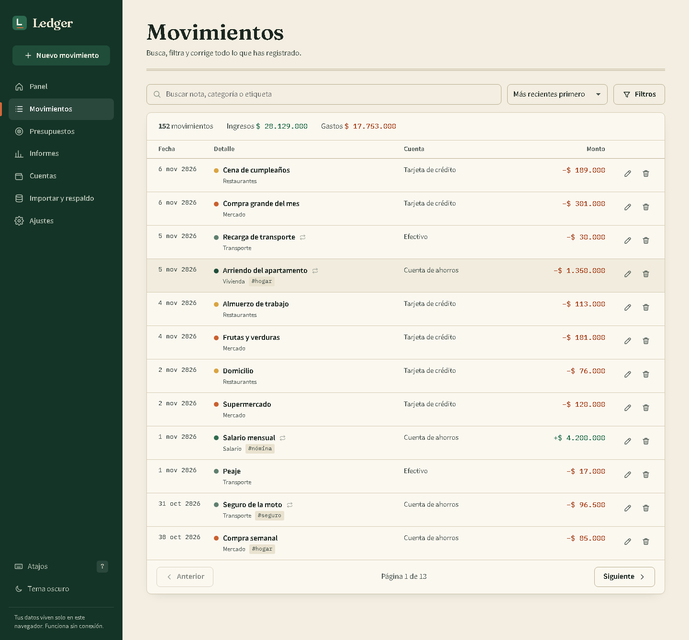
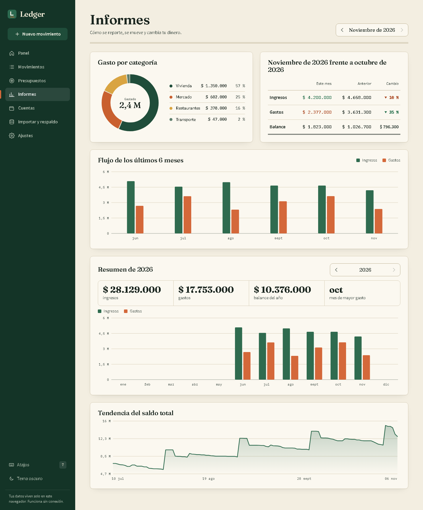
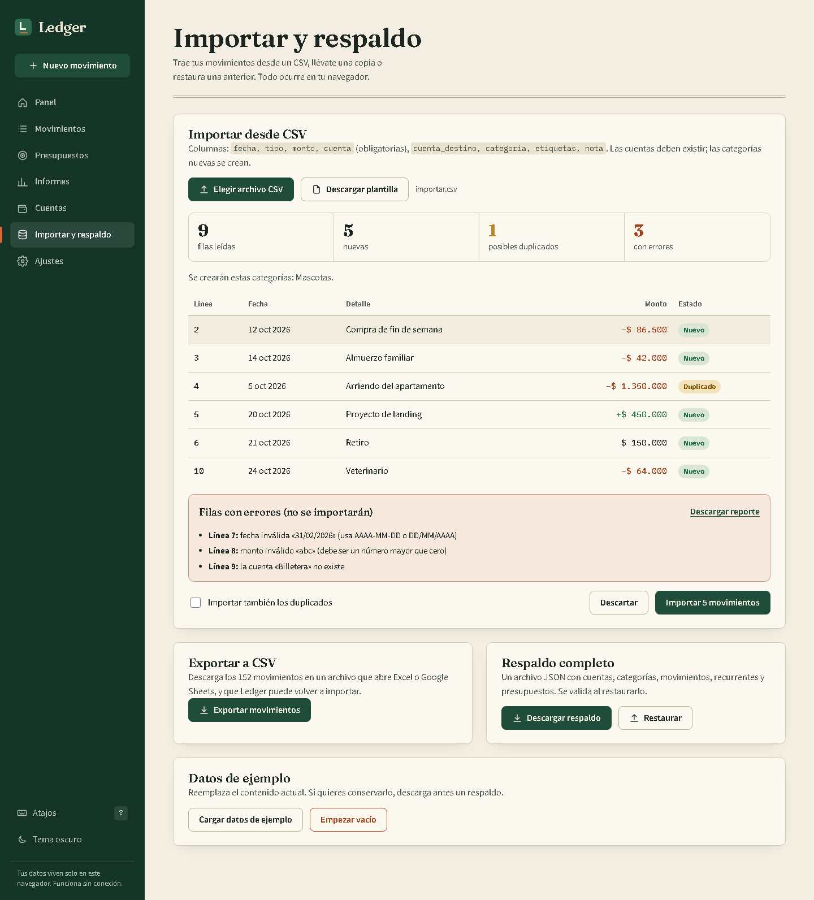
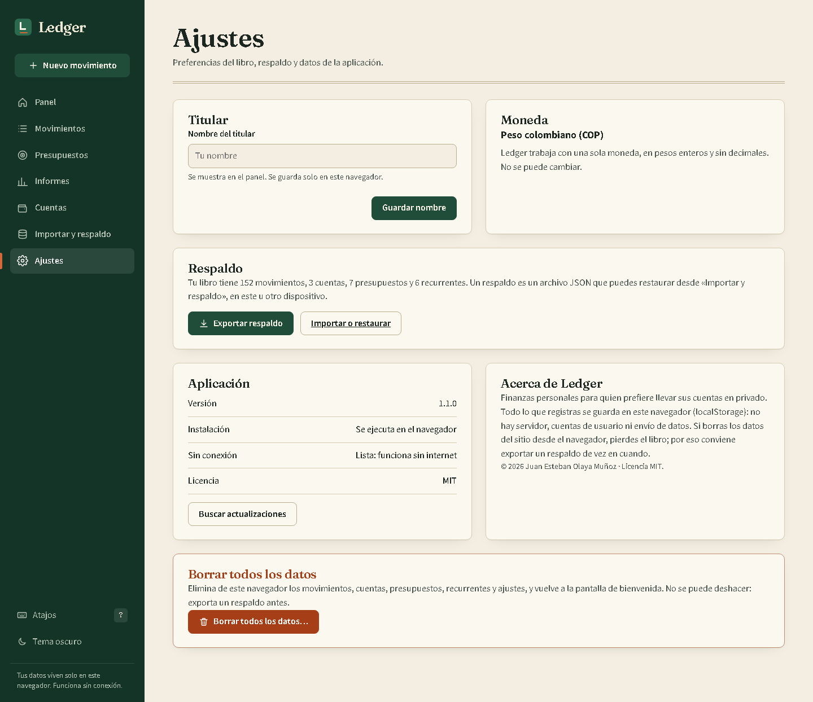

# Ledger

Aplicación web instalable de finanzas personales en pesos colombianos (COP). Registras cuentas y movimientos, fijas presupuestos mes a mes, importas tus extractos en CSV y ves a dónde se va el dinero. Funciona sin conexión, no necesita cuenta ni servidor y no envía un solo dato a ningún lado.

- Aplicación: <https://juanxd2201.github.io/portfolio/labs/ledger/>
- Licencia MIT · © 2026 Juan Esteban Olaya Muñoz



## Primeros pasos

Al abrir la aplicación por primera vez eliges cómo empezar:

- **Empezar con una base vacía**: una cuenta de efectivo y las categorías básicas.
- **Cargar datos de ejemplo**: seis meses de movimientos, tres cuentas y presupuestos para explorar la aplicación. Se pueden borrar cuando quieras desde «Ajustes».

La elección queda guardada junto con tus datos; la bienvenida no vuelve a aparecer salvo que borres todos los datos.



## Instalarla como aplicación

Ledger es una aplicación web progresiva (PWA):

- **Chrome o Edge (escritorio y Android)**: usa el botón «Instalar aplicación» de la barra lateral o de «Ajustes», o el icono de instalación de la barra de direcciones.
- **Safari (iPhone y iPad)**: Compartir → «Añadir a pantalla de inicio».
- Tras la primera carga **todo el contenido queda en caché**: la aplicación abre y funciona sin internet, incluidas las fuentes.
- Cuando se publica una versión nueva aparece el aviso **«Hay una versión nueva»** con un botón **Recargar**; nada se actualiza sin que lo decidas.

Se sirve con rutas relativas y navegación por hash, así que funciona bajo cualquier subruta (por ejemplo `/portfolio/labs/ledger/`).


## Funcionalidades

**Cuentas y movimientos**
- Cuentas de efectivo, banco y tarjeta de crédito. El saldo siempre se calcula a partir de los movimientos; nunca se guarda un saldo a mano.
- Gastos, ingresos y transferencias entre cuentas (el patrimonio total no cambia al transferir).
- Crear, editar y eliminar, con aviso para deshacer la eliminación.
- Categorías, etiquetas y notas.
- Búsqueda por texto (sin distinguir tildes), filtros por fecha, categoría, cuenta, tipo, etiqueta y rango de monto; orden por fecha o monto; paginación.

**Recurrentes**
- Reglas semanales o mensuales. Al abrir la app se generan los movimientos pendientes hasta hoy, sin duplicar nada.
- Las mensuales conservan el día original: una regla del 31 cae el 28 (o 29) en febrero y vuelve al 31 en marzo.

**Presupuestos por mes**
- Un límite por categoría y por mes, con barra de progreso, aviso al 80 % y alerta al 100 %. Gastar exactamente el límite ya cuenta como «límite alcanzado».
- Puedes ajustar un mes sin tocar los demás, **copiar los presupuestos al mes siguiente** como plantilla y quitar los ajustes de un mes para volver a la plantilla base.
- Al guardar un gasto que cruza un umbral, la app te lo dice en el momento.



**Informes**
- Gasto por categoría (dona), flujo de los últimos seis meses (barras), tendencia del patrimonio (línea con lectura por puntero y teclado) y comparación con el mes anterior.
- **Resumen anual**: ingresos, gastos, balance y mes de mayor gasto de cualquier año, con gráfico de doce meses.

**Datos y respaldo**
- Importar CSV con validación fila a fila, vista previa, detección de duplicados, categorías nuevas y reporte de errores descargable.
- Exportar CSV (que la propia app puede reimportar) y respaldo JSON completo, validado al restaurar.

**Ajustes**
- Nombre del titular, moneda fija (COP), exportar respaldo, versión de la aplicación y estado de instalación y de uso sin conexión.
- **Borrar todos los datos**: exige escribir `BORRAR`, ofrece descargar un respaldo antes y deja el navegador limpio.

**Experiencia**
- Tema claro y oscuro (respeta la preferencia del sistema).
- Atajos: `N` nuevo movimiento, `/` buscar, `G` y una letra para navegar (incluye `G` `A` para ajustes), `T` tema, `?` ayuda.
- Estados vacíos, de carga y de error pensados uno por uno, incluido el caso de datos guardados corruptos.
- Accesibilidad: navegación completa por teclado, enlace para saltar al contenido, diálogos nativos con foco atrapado, roles ARIA, foco visible, contraste de al menos 4,5:1 en los pares de color principales de ambos temas y `prefers-reduced-motion`.
- Responsive: barra lateral en escritorio y navegación inferior con botón flotante en móvil.

## Privacidad y alcance

- **Todos los datos quedan en tu navegador** (`localStorage`). No hay servidor, cuentas, analítica ni peticiones de red con tu información.
- Un solo dispositivo: no hay sincronización. Para mover tus datos usa el respaldo JSON.
- Si borras los datos del sitio desde el navegador, pierdes el libro; exporta un respaldo de vez en cuando. La aplicación pide al navegador almacenamiento persistente para reducir ese riesgo.
- Moneda única (COP), sin decimales. Ledger es una herramienta de registro personal, no asesoría financiera ni contable.

## Capturas

| Movimientos | Informes (con resumen anual) |
| --- | --- |
|  |  |

| Importación de CSV | Ajustes |
| --- | --- |
|  |  |

Tema oscuro: [panel](docs/screenshots/panel-escritorio-oscuro.png), [movimientos](docs/screenshots/movimientos-escritorio-oscuro.png), [presupuestos](docs/screenshots/presupuestos-escritorio-oscuro.png), [informes](docs/screenshots/informes-escritorio-oscuro.png), [ajustes](docs/screenshots/ajustes-escritorio-oscuro.png).
Móvil (390 × 844): [bienvenida](docs/screenshots/bienvenida-movil.png), [panel](docs/screenshots/panel-movil.png), [movimientos](docs/screenshots/movimientos-movil.png), [presupuestos](docs/screenshots/presupuestos-movil.png), [informes](docs/screenshots/informes-movil.png), [ajustes](docs/screenshots/ajustes-movil.png).

## Stack

- Vite + React 19 + TypeScript en modo estricto (`noUncheckedIndexedAccess` incluido).
- Sin backend: sitio estático, persistencia en `localStorage` con esquema versionado y migración.
- PWA propia: manifiesto, iconos PNG generados desde un SVG, y un service worker que `pwa-plugin.ts` genera en el build con el listado de archivos y un hash de versión.
- Gráficos en SVG propio (sin librerías de gráficos).
- Tipografías autoalojadas con Fontsource: Fraunces (titulares), Source Sans 3 (texto) e IBM Plex Mono (cifras tabulares).
- Jest + ts-jest para el dominio; Playwright (`playwright-core` con el Chrome instalado) para e2e.
- Dependencias de ejecución: `react`, `react-dom` y las tres fuentes.

## Instalación y scripts

Requiere Node 20 o superior (desarrollado y probado con Node 25).

```bash
npm install
npm run dev          # servidor de desarrollo
npm run build        # comprueba tipos y genera dist/ (incluye sw.js)
npm run preview      # sirve dist/ en http://127.0.0.1:4173
npm run typecheck    # tsc --noEmit
npm test             # pruebas de dominio con Jest
npm run test:e2e     # e2e con Playwright sobre dist/ (requiere build previo)
npm run capturas     # regenera docs/screenshots/ desde el build
npm run iconos       # regenera los iconos PNG de public/icons
```

Las pruebas e2e y las capturas usan Chrome ya instalado (`C:/Program Files/Google/Chrome/Application/chrome.exe` en Windows); `playwright-core` no descarga navegadores. Si tu Chrome está en otra ruta, ajusta `CHROME_PATHS` en `e2e/lib.mjs`.

## Estructura

```
src/
  domain/        Tipos y funciones puras: saldos, presupuestos por mes, recurrencias,
                 agregaciones, filtros, CSV, esquema/migración, datos de ejemplo
  storage/       Interfaz LedgerRepository e implementación sobre localStorage
  pwa.ts         Registro del service worker, aviso de actualización e instalación
  ui/
    components/  Modal, formulario de movimientos, tabla, controles de la PWA
    charts/      Dona, barras y línea de tendencia en SVG
    pages/       Bienvenida, Panel, Movimientos, Presupuestos, Informes, Cuentas, Datos, Ajustes
    store.tsx    Estado, persistencia y acciones
  test/          Pruebas Jest del dominio y del repositorio
pwa-plugin.ts    Plugin de Vite que genera sw.js
scripts/         Generación de iconos
e2e/             Pruebas Playwright y script de capturas
docs/            ARQUITECTURA.md y capturas
```

La explicación completa está en [docs/ARQUITECTURA.md](docs/ARQUITECTURA.md).

## Decisiones técnicas

- **Dinero en enteros.** Los montos son pesos enteros; el COP no usa centavos en la práctica y así se evitan errores de coma flotante. Las comparaciones de presupuesto usan aritmética entera.
- **Saldos derivados.** Una cuenta guarda solo su saldo inicial; el saldo actual sale de recorrer los movimientos.
- **Fechas como texto ISO.** `AAAA-MM-DD`, sin hora ni zona, para evitar desfases de un día.
- **Recurrencias idempotentes.** Cada movimiento generado tiene un identificador determinista y la regla recuerda hasta dónde generó.
- **Presupuestos con plantilla.** Una entrada sin mes es la plantilla base; una entrada con mes la reemplaza solo en ese mes (con límite 0 se oculta la categoría ese mes).
- **Esquema versionado.** Lo guardado lleva `schemaVersion`; al leer se migra y se valida estructura e integridad referencial. Si los datos están corruptos no se tocan: la app ofrece descargar una copia.
- **Service worker versionado por contenido.** El hash de todos los archivos cambia el nombre de la caché; la versión nueva espera a que pulses «Recargar» y las cachés viejas se eliminan al activarla.
- **CSV defensivo.** Parser propio con comillas, saltos de línea internos, separadores `,` `;` o tabulación y BOM; la exportación neutraliza celdas que empiezan por `=`, `+` o `@`.
- **Sin secretos.** No hay `.env`, claves ni llamadas de red; las fuentes van empaquetadas.

## Pruebas

Última ejecución completa:

| Tipo | Resultado |
| --- | --- |
| Verificación de tipos (`npx tsc --noEmit`) | sin errores |
| Jest, dominio y repositorio | 104 pruebas en 7 archivos, todas pasan |
| Playwright e2e sobre el build de producción | 33 pruebas, todas pasan |
| `npm run build` | `dist/` generado con `sw.js` y precaché de todos los archivos |

Las pruebas de dominio cubren años bisiestos y fin de mes, recurrencias del día 31, transferencias, umbrales del presupuesto, presupuestos por mes (ajuste, ocultar, copiar, restablecer), CSV con casos límite, ida y vuelta del respaldo y migración v1 → v2.

Los e2e recorren flujos reales: bienvenida y decisión recordada, crear/editar/eliminar con deshacer, validaciones, transferencias, alertas de presupuesto, filtros, importar y exportar, respaldo y restauración, ajustes y borrado total con confirmación, presupuestos por mes, informe anual, manifiesto e iconos, **uso sin conexión** (recarga y navegación con la red cortada, incluso guardando un movimiento), **actualización con aviso «Hay una versión nueva»**, botón de instalación, atajos, foco, ausencia de desbordes en móvil, datos corruptos y migración. Todas verifican además que la consola no registre errores.
